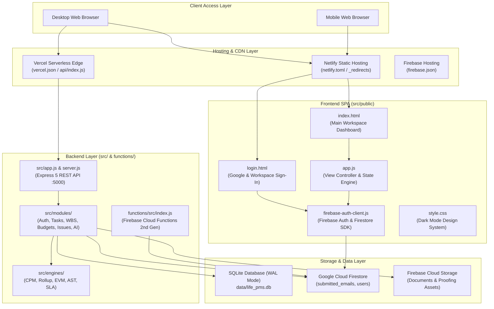

# Life Project Management System (ZOHO)
## Complete Monorepo Architecture & Technical Specification Document

---

### Document Overview

| Property | Value |
|---|---|
| **Project Name** | Life Project Management System (Zoho Projects & Linear Alternative) |
| **Repository URL** | [https://github.com/webmaskadevelopement-ship-it/ZOHO](https://github.com/webmaskadevelopement-ship-it/ZOHO) |
| **Git Clone URL** | `https://github.com/webmaskadevelopement-ship-it/ZOHO.git` |
| **Default Branch** | `main` |
| **Production Target** | Netlify (`https://sunny-dolphin-0b3013.netlify.app`), Vercel, Firebase |
| **Primary Architecture** | Unified Monorepo (Frontend SPA + Express REST API + Cloud Functions + Engines) |
| **Runtime Version** | Node.js v22+ / v24+ |

---

### 1. Monorepo System Architecture

The following diagram illustrates the relationship between the client applications, serverless entry points, core backend engines, database persistence layers, and external cloud integrations:



---

### 2. Monorepo Directory Structure

```
ZOHO/                                  # Monorepo Workspace Root
├── .agents/                           # Agent customizations, skills, and rules
│   └── skills/                        # Workspace-specific skills
├── .firebaserc                        # Firebase project alias mapping (zoho-cda77)
├── .gitignore                         # Version control exclusions (.env, node_modules, *.db-wal)
├── firebase.json                      # Firebase Hosting, Functions & Emulator configuration
├── firestore.indexes.json             # Firestore composite indexing rules
├── firestore.rules                    # Security rules for Firestore client collections
├── storage.rules                      # Security rules for Cloud Storage buckets
├── netlify.toml                       # Netlify build scripts, publish directory & rewrites
├── vercel.json                        # Vercel serverless functions configuration & route rewrites
├── package.json                       # Monorepo root manifest, scripts & dependencies
├── README.md                          # Human-readable project documentation
├── SKILL.md                           # Behavioral guidelines and operational protocols
│
├── api/                               # Vercel Serverless Function Gateway
│   └── index.js                       # Imports and exposes src/app.js as a serverless handler
│
├── data/                              # Database & Persistent File Assets
│   ├── life_pms.db                    # Primary SQLite relational database file
│   ├── templates/                     # Ingestion schemas (real_data_template.json)
│   └── uploads/                       # Local disk storage for attachment fallback
│
├── dist/                              # Production Distribution Bundle (Generated)
│   ├── _redirects                     # Production Netlify/Cloudflare SPA routing rules
│   ├── index.html                     # Optimized dashboard HTML
│   ├── login.html                     # Optimized authentication HTML
│   ├── app.js                         # Production client runtime script
│   ├── style.css                      # Production stylesheet
│   └── firebase-auth-client.js        # Production Firebase client module
│
├── functions/                         # Google Firebase Cloud Functions (2nd Gen Node.js 22)
│   ├── package.json                   # Cloud Functions specific dependencies
│   └── src/                           # Function triggers, auth blockers & callables
│       ├── index.js                   # Cloud Function exports (validateLogin, auth hooks)
│       └── modules/                   # Cloud-side business validation logic
│
├── scripts/                           # DevOps & Build Utility Scripts
│   ├── build.js                       # Copies assets to ./dist and generates _redirects
│   └── importRealData.js              # Command-line utility for atomic JSON data ingestion
│
├── src/                               # Primary Application Source Code
│   ├── server.js                      # Standalone HTTP server entry point (Port 5000)
│   ├── app.js                         # Express 5 application setup, CORS, JSON & routing
│   ├── config.js                      # Environment and path resolution configuration
│   │
│   ├── db/                            # Relational Database Abstraction
│   │   ├── database.js                # SQLite connection wrapper with WAL journal mode
│   │   ├── schema.sql                 # Complete DDL tables and relational constraints
│   │   ├── seed.js                    # Comprehensive test fixture and sample data seeder
│   │   ├── seedInvites.js             # Invited members schema and initial data
│   │   └── migrateSchema.js           # Automated structural schema migrations
│   │
│   ├── engines/                       # Algorithmic Computation Engines
│   │   ├── astFilterEngine.js         # Boolean query parser (e.g. "(1 AND 2) OR 3")
│   │   ├── criticalPathEngine.js      # Directed Acyclic Graph (DAG) Critical Path calculator
│   │   ├── evmEngine.js               # Earned Value Management (PV, EV, AC, CPI, SPI)
│   │   ├── slaEngine.js               # Automated bug triage deadlines & escalation timer
│   │   └── wbsRollupEngine.js         # Bottom-up tree cost, hours, and progress rollup
│   │
│   ├── middleware/                    # Express HTTP Request Interceptors
│   │   ├── auth.js                    # JWT Bearer token authentication & RBAC policy guard
│   │   └── errorHandler.js            # Global uniform JSON error responses
│   │
│   ├── modules/                       # Domain Modules (Controller + Service Pattern)
│   │   ├── ai/                        # Gemini 2.5 Pro WBS Co-Pilot & Risk Summarizer
│   │   ├── auth/                      # Authentication, Login, Register, Profile & PAT tokens
│   │   ├── automation/                # Trigger/Action Webhooks & event-driven automation
│   │   ├── blueprints/                # Finite State Machine workflow blueprint transitions
│   │   ├── budgets/                   # EVM metrics, rate cards, and client invoicing
│   │   ├── collaboration/             # Asset folders, versioned files, visual proofing, chat
│   │   ├── custom-fields/             # Dynamic layout custom fields & formula evaluator
│   │   ├── integrations/              # Firebase Firestore dual-sync & cloud connectors
│   │   ├── issues/                    # Bug tracking, severity matrix, Git commit webhooks
│   │   ├── phases/                    # Sequential phase chaining & release notes generator
│   │   ├── portals/                   # Multi-tenant portal scoping & custom domains
│   │   ├── projects/                  # Project CRUD, budgeting & group categorization
│   │   ├── reports/                   # Scenario Flight Simulator & SVG vector Gantt chart
│   │   ├── roles/                     # Granular RBAC permissions & cost masking policies
│   │   ├── tags/                      # Global project and task taxonomy tags
│   │   ├── task-lists/                # Task list groupings and sequence order
│   │   ├── tasks/                     # 5-Level Work Breakdown Structure (WBS) & Subtasks
│   │   ├── teams/                     # Departmental team rosters and assignments
│   │   ├── timesheets/                # Stopwatch timer, weekly timesheet logging & approvals
│   │   └── views/                     # Kanban board, Gantt chart, and Eisenhower matrix
│   │
│   ├── public/                        # Frontend Web Application (Vanilla HTML/CSS/JS)
│   │   ├── index.html                 # Workspace dashboard interface
│   │   ├── login.html                 # Authentication login screen
│   │   ├── style.css                  # Modern dark-mode styling and UI components
│   │   ├── app.js                     # SPA router, event listeners & static fallback engine
│   │   ├── firebase-auth-client.js    # Client-side Firebase SDK configuration
│   │   └── _redirects                 # Netlify SPA redirect configuration
│   │
│   └── services/                      # Shared Cross-Cutting Infrastructure Services
│       ├── dataIngestionService.js    # Atomic JSON transactional data importer
│       ├── firebaseAuthService.js     # Firebase token verification & user provisioning
│       └── workerRunner.js            # Background recurring task and reminder executor
│
└── tests/                             # Automated Test Suites (71 Tests, 38 Suites)
    ├── backend.test.js                # Core API, CPM, WBS, EVM, and client visibility
    ├── firebase.test.js               # Firebase Cloud Functions & Firestore engine tests
    ├── login_validation.test.js       # Whitelist, credentials, and Google login tests
    └── deep_audit_modules.test.js     # Invoicing, Blueprints, Proofing, and RBAC audits
```

---

### 3. Core Modules & Subsystems

#### 3.1 5-Level Work Breakdown Structure (WBS)
- **Hierarchy**: `Portal → Project → Phase → Task List → Task → Subtask (Depth 5)`
- **Materialized Paths**: Tasks store their ancestry using `ancestor_ids` JSON arrays and path strings, enabling $O(1)$ tree lookups without recursive SQL CTE performance penalties.
- **Auto-Rollup**: The `wbsRollupEngine.js` calculates aggregate progress percentage, planned costs, and actual work hours upward from leaf tasks to the project root.

#### 3.2 Critical Path Method (CPM) Engine
- Located in `src/engines/criticalPathEngine.js`.
- Constructs a Directed Acyclic Graph (DAG) using topological sort to detect dependency deadlocks and circular loops (`Task A → Task B → Task A`).
- Computes **Early Start (ES)**, **Early Finish (EF)**, **Late Start (LS)**, **Late Finish (LF)**, and **Total Float (Slack)**. Tasks with `Float = 0` are flagged as Critical Path tasks.
- Dynamically cascades date adjustments to downstream successor tasks when an upstream task deadline slips.

#### 3.3 Earned Value Management (EVM) Analytics
- Located in `src/engines/evmEngine.js`.
- Computes real-time project health metrics:
  - **Planned Value (PV)**: Budgeted cost of work scheduled.
  - **Earned Value (EV)**: Budgeted cost of work performed.
  - **Actual Cost (AC)**: Actual expenses and logged work hours.
  - **Cost Performance Index (CPI)**: $EV / AC$ ($>1.0$ indicates under budget).
  - **Schedule Performance Index (SPI)**: $EV / PV$ ($>1.0$ indicates ahead of schedule).
  - **Estimate at Completion (EAC)** & **Variance at Completion (VAC)**.

#### 3.4 Role-Based Access Control (RBAC) & Client Isolation
The system provides four primary user tiers enforced by `src/middleware/auth.js`:
1. **Admin**: Unrestricted workspace control, user management, billing, rate cards, and workflow automation.
2. **Manager**: Project creation, timesheet approval, milestone tracking, and flight simulation.
3. **Employee**: Task completion, bug logging, personal stopwatch tracking. Financial hourly cost rates are masked.
4. **Client (Strict Isolation)**: Restricted exclusively to external-flagged deliverables. Internal tasks, timesheets, employee hourly rates, and EVM margins are completely stripped from API responses.

---

### 4. REST API Endpoint Catalog

All API endpoints are prefixed with `/api/v1`:

| Method | Endpoint | Description | Protected |
|---|---|---|---|
| `POST` | `/api/v1/auth/login` | Email/password session login | No |
| `POST` | `/api/v1/auth/firebase-login` | Exchanges Firebase ID token for PMS session token | No |
| `POST` | `/api/v1/auth/google-validate` | Verifies Google Auth token and provisions user | No |
| `GET` | `/api/v1/auth/me` | Retrieves active user profile and permissions | Yes |
| `GET` | `/api/v1/projects` | Lists accessible projects (filtered by role) | Yes |
| `POST` | `/api/v1/projects` | Creates new project with budget configuration | Yes (Admin/PM) |
| `GET` | `/api/v1/tasks/project/:projectId` | Fetches tasks with WBS hierarchy and assignees | Yes |
| `POST` | `/api/v1/tasks/project/:projectId` | Creates new task under specified task list | Yes |
| `PATCH` | `/api/v1/tasks/:id/quick-status` | Toggles task open/completed status | Yes |
| `GET` | `/api/v1/views/kanban/:projectId` | Returns Kanban columns (Open, In Progress, In Review, Completed) | Yes |
| `GET` | `/api/v1/views/gantt/:projectId` | Returns timeline data and Critical Path indicators | Yes |
| `GET` | `/api/v1/views/matrix/:projectId` | Returns Eisenhower 2x2 matrix categorizations | Yes |
| `GET` | `/api/v1/budgets/evm/:projectId` | Calculates real-time EVM metrics (CPI, SPI, EAC) | Yes |
| `GET` | `/api/v1/timesheets` | Queries logged hours by project and date range | Yes |
| `POST` | `/api/v1/timesheets/timesheets/:id/approve` | Approves submitted employee work log | Yes (Manager) |
| `POST` | `/api/v1/collaboration/files/upload` | Uploads and registers file asset in Document Vault | Yes |
| `POST` | `/api/v1/ai/wbs-copilot` | Generates 5-level WBS using Gemini AI | Yes |

---

### 5. Multi-Cloud Deployment Configurations

#### Netlify Configuration (`netlify.toml` & `src/public/_redirects`)
```toml
[build]
  publish = "dist"
  command = "npm run build"

[[redirects]]
  from = "/login"
  to = "/login.html"
  status = 200

[[redirects]]
  from = "/login/*"
  to = "/login.html"
  status = 200

[[redirects]]
  from = "/*"
  to = "/index.html"
  status = 200
```

#### Vercel Serverless Configuration (`vercel.json`)
```json
{
  "version": 2,
  "buildCommand": "npm run build",
  "outputDirectory": "dist",
  "rewrites": [
    { "source": "/api/(.*)", "destination": "/api/index.js" },
    { "source": "/login", "destination": "/login.html" },
    { "source": "/(.*)", "destination": "/index.html" }
  ]
}
```

#### Firebase Configuration (`firebase.json`)
- **Hosting**: Publishes `src/public` with rewrites directing `/api/**` to Cloud Function `api` and `**` to `/index.html`.
- **Functions**: Node.js 22 codebase in `./functions` exporting 2nd Gen callables and auth blockers.
- **Firestore & Storage**: Secure production rules defined in `firestore.rules` and `storage.rules`.

---

### 6. Development & Operations Guide

#### Prerequisites
- Node.js version 20.x, 22.x, or 24.x
- Git

#### Installation & Execution Commands
```powershell
# 1. Clone repository
git clone https://github.com/webmaskadevelopement-ship-it/ZOHO.git
cd ZOHO

# 2. Install dependencies
npm install

# 3. Start local development server (Express API + Static Frontend on http://localhost:5000)
npm run dev

# 4. Run automated test suite (71 Tests across 38 Suites)
npm test

# 5. Build production distribution bundle (Outputs to ./dist)
npm run build

# 6. Import real production data template
npm run data:import
```
